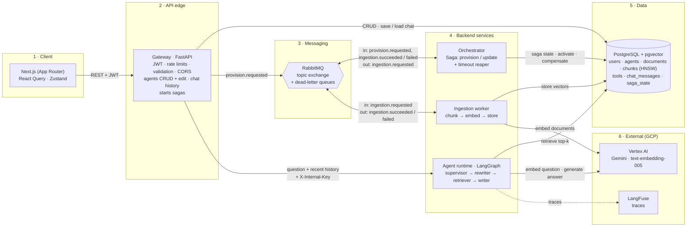
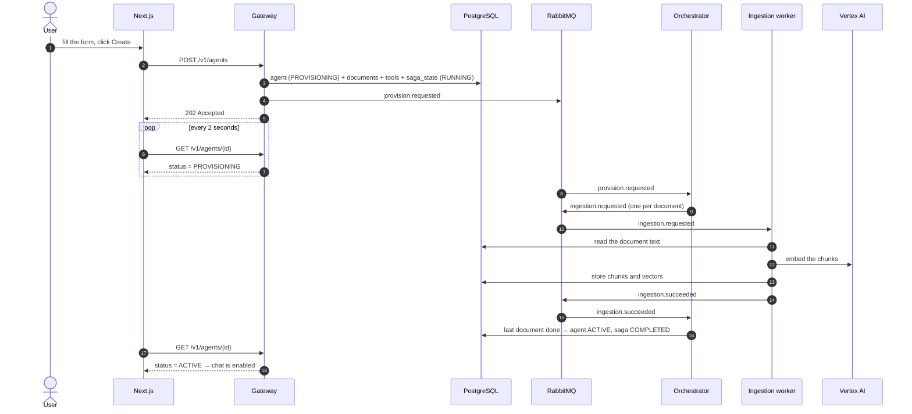
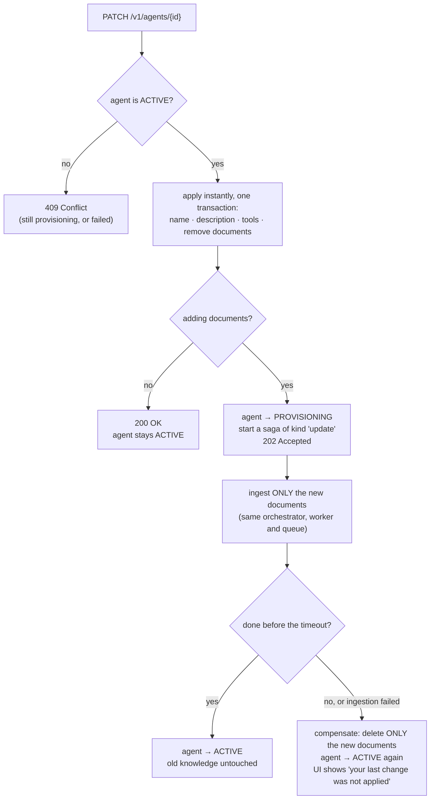
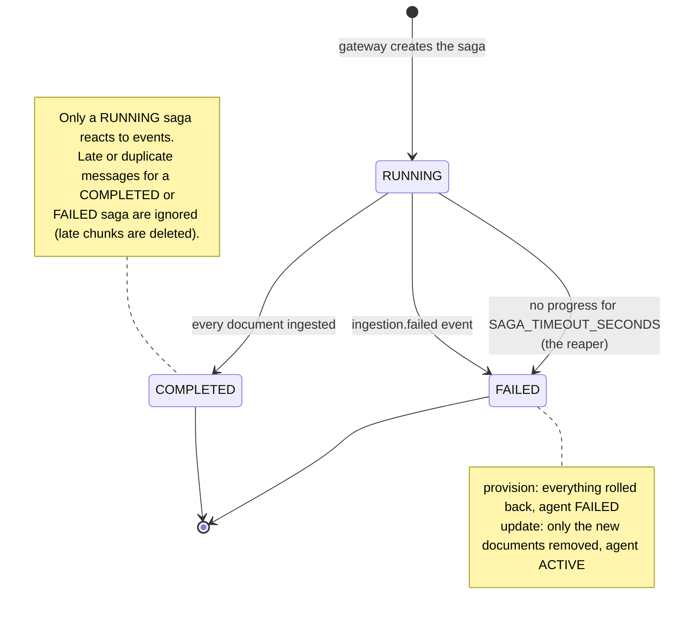
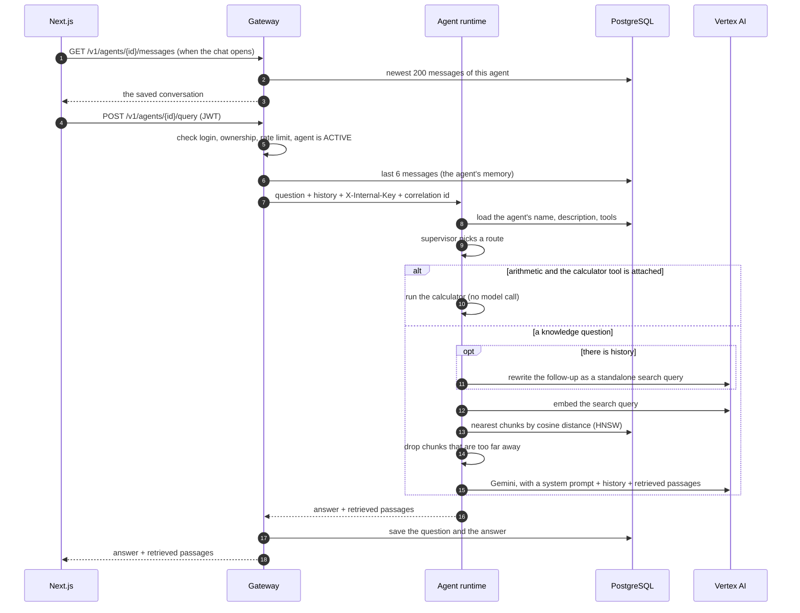

# Architecture

Agent Studio lets a business user create an AI agent, give it documents and
tools, edit it later, and chat with it. Everything below is drawn from the code
as it is today. GitHub renders the diagrams; the system overview is also kept
as a standalone file, [`architecture.mmd`](architecture.mmd).

## 1. The system

**In one breath:** the gateway is the only public service. Anything slow
(embedding documents) is handed to RabbitMQ so the user gets an immediate answer
and can watch the progress. The orchestrator coordinates that slow work as a
**saga** and keeps its state in Postgres, so it can be rolled back if it fails.

Only IDs travel on the queue. The document text stays in Postgres and the worker
reads it from there, so messages stay small.

## 2. Creating an agent (the saga)

**Why a saga?** Creating an agent touches several services (database, queue,
embedding API). There is no single transaction across them, so if step 3 of 4
fails you must undo steps 1 and 2 yourself. That undo is the *compensation*.

## 3. Editing an agent

**The design choice worth explaining:** name, description and tools are read from
the database on every question, so changing them needs no background work and
takes effect immediately. Only *new documents* need embeddings, which is slow and
can fail, so only that part goes through the saga. When it fails, the saga undoes
just what it added: one bad upload must not destroy an agent that was working.

While an edit saga runs, further edits are refused with `409` (the agent row is
locked while the request is checked, so two simultaneous edits cannot both start).

## 4. The life of a saga

Three rules keep it trustworthy when RabbitMQ delivers messages late, twice, or
never:

1. **Only a RUNNING saga reacts to events.** A stray "failed" message cannot
   wreck an agent that is already ACTIVE, and a worker that finishes *after* a
   rollback has its orphan chunks deleted.
2. **Each handler locks the saga row** (`SELECT … FOR UPDATE`), so two events for
   the same saga are processed one at a time.
3. **A saga that stops making progress is failed by a timeout.** The orchestrator
   runs a small loop every `SAGA_REAPER_INTERVAL_SECONDS` that rolls back any
   RUNNING saga idle for `SAGA_TIMEOUT_SECONDS`. This covers a lost message, a
   crashed worker, or a poison message sitting in a dead-letter queue.

## 5. Asking a question (and how the chat remembers)

The runtime is not public: it rejects any call without the shared
`X-Internal-Key` that only the gateway adds, and its port is not published.

**How the memory works**

- **The gateway owns the conversation, the runtime stays stateless.** The gateway
  already knows who the user is and which agent they own, so it stores the
  messages (`chat_messages`, one conversation per agent) and sends the last 6 with
  each question. The runtime needs no database table for chat and can be scaled
  or restarted freely.
- **Everything is stored, only a little is remembered.** The screen reloads the
  newest 200 messages; the agent sees the last 6, each cut to 1,500 characters,
  which is enough for "and what about the second one?" without a big prompt.
  "Clear chat" deletes the stored messages, so the agent forgets them too.
- **A follow-up is rewritten before searching.** "and for digital products?" has
  no meaning to a vector search, so with history the model first turns it into
  "refund window for digital products". The first question of a conversation skips
  this step (nothing to resolve, one model call saved), and if the rewrite fails
  the original question is searched instead.
- **Saved only after the answer succeeded.** If the runtime is down or times out,
  nothing is written, so a failed question never sits in the history. The UI keeps
  the typed text so the user can simply retry.

## 6. Where to look in the code

| Topic | File |
|---|---|
| Public API, auth, rate limits, edit, chat history | `services/gateway/src/gateway/main.py` |
| Saga rules, compensation, timeout query | `services/orchestrator/src/orchestrator/saga.py` |
| Event handlers and the reaper loop | `services/orchestrator/src/orchestrator/runner.py` |
| Chunk → embed → store | `services/ingestion-worker/src/ingestion_worker/` |
| LangGraph route / rewrite / retrieve / write | `services/agent-runtime/src/agent_runtime/graph.py` |
| RabbitMQ topology, DLQs | `packages/common/src/common/messaging.py` |
| Message contracts | `packages/common/src/common/messages.py` |
| Tables and indexes | `packages/db/src/db/models.py`, `packages/db/migrations/` |
| What the edit form sends | `frontend/src/lib/agentDiff.ts` |
| Chat screen (loads the saved conversation) | `frontend/src/app/agents/[id]/page.tsx` |
